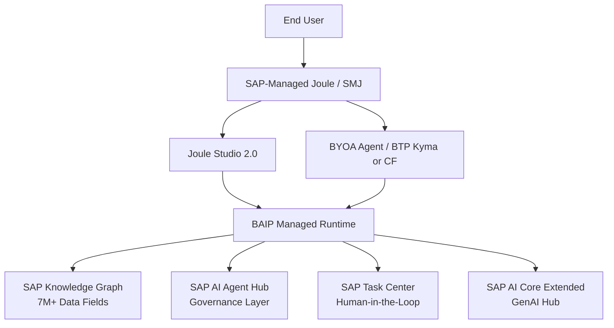

<!-- loio870f31e9ac1b438e93d58093078dc4d6 -->

# Agent Development Concept — CIS Industry AI

SAP's Industry AI portfolio deploys autonomous agents across high-stakes enterprise processes — from batch release decisions in regulated manufacturing to commodity hedging and pricing at scale. This reference architecture establishes the governance constraints, design principles, customer prerequisites, and design questions that apply to every agent delivery in this context. It maps thirteen core design questions to the topics in this guide and defines the non-negotiable delivery constraints that practitioners must satisfy before beginning a Development sprint.

<a name="loio870f31e9ac1b438e93d58093078dc4d6__section_opportunity_and_risk"/>

## The Opportunity and the Risk

SAP's Industry AI portfolio brings autonomous agents to the most complex, high-stakes processes in industrial enterprises: batch release decisions in regulated manufacturing, commodity hedging positions, pricing recommendations at scale, asset maintenance strategies. These are processes where getting it right generates significant business value — and where getting it wrong has regulatory, financial, or operational consequences.

This is precisely what makes AI agents different from conventional software in these contexts. A traditional application either works or it doesn't; the failure mode is visible. An AI agent reasons, selects tools, and acts on its own judgment. It can appear to work — completing each individual step correctly — while still producing wrong outputs, following unsafe paths, or drifting in quality over time in ways that are not immediately visible.

Governing agents well is not an optional add-on to Industry AI delivery. It is the condition under which enterprises can trust agents to act autonomously on high-stakes decisions, and the foundation on which value-based contracts (10–30% of yearly customer benefit) can be justified.

<a name="loio870f31e9ac1b438e93d58093078dc4d6__section_architecture"/>

## Architecture Overview

The CIS Agent Development Concept operates across three internal BAIP layers: a **Context layer** (the SAP Knowledge Graph with 7M+ data fields, unified across SAP and non-SAP systems), a **Build layer** (Joule Studio), and a **Governance layer** (SAP AI Agent Hub). Every agent design in this document targets one or more of these layers.

**CIS Agent Development — Core Components**

<table>
<tr>
<th valign="top">

Component

</th>
<th valign="top">

Layer

</th>
<th valign="top">

Description

</th>
</tr>
<tr>
<td valign="top">

SAP-Managed Joule \(SMJ\)

</td>
<td valign="top">

Orchestrator

</td>
<td valign="top">

Default orchestrator for all new FDE engagements. Receives new capabilities including Joule Work, Joule Studio 2.0, and new LoB onboarding. GA since 2026-06-01.

</td>
</tr>
<tr>
<td valign="top">

Joule Studio 2.0

</td>
<td valign="top">

Build Layer

</td>
<td valign="top">

Low-code build environment for standard Industries Development agents. Hosts agents that register to SMJ via A2A. Currently in phased GA.

</td>
</tr>
<tr>
<td valign="top">

BYOA Agent Runtime

</td>
<td valign="top">

Build Layer

</td>
<td valign="top">

Standard runtime for productization-intent FDE agents on the customer's own BTP subaccount (LangGraph, AG2, CAP, CrewAI). Registered to SMJ via outbound A2A.

</td>
</tr>
<tr>
<td valign="top">

SAP Knowledge Graph

</td>
<td valign="top">

Context Layer

</td>
<td valign="top">

7M+ data fields unified across SAP and non-SAP systems. Provides grounded, canonical entity resolution for all agent reasoning.

</td>
</tr>
<tr>
<td valign="top">

SAP AI Agent Hub

</td>
<td valign="top">

Governance Layer

</td>
<td valign="top">

Central governance control plane for monitoring, policy enforcement, and lifecycle management of deployed agents.

</td>
</tr>
<tr>
<td valign="top">

SAP Task Center

</td>
<td valign="top">

Governance Layer

</td>
<td valign="top">

Human-in-the-loop \(HITL\) implementation mechanism. Every agent design includes an explicit escalation path to a human through Task Center.

</td>
</tr>
<tr>
<td valign="top">

SAP AI Core Extended

</td>
<td valign="top">

Infrastructure

</td>
<td valign="top">

Required service plan for GenAI Hub access. Must be provisionable in the customer's BAIP region before an agent engagement is feasible.

</td>
</tr>
</table>

<a name="loio870f31e9ac1b438e93d58093078dc4d6__section_design_questions"/>

## Core Design Questions

This document was developed by CIS (Customer Industry Solutions) Technology and Operations team as a design concept for building, monitoring, and governing AI agents within SAP's Industry AI and FDE (Forward Deployed Engineering) context. SAP positions Industry AI as a fifth element of the Autonomous Enterprise stack — providing "built-in vertical expertise with sector-specific process logic, data models, and regulatory logic" on top of the generic agentic platform. CIS is the delivery engine for this layer: the central, customer-anchored Industry AI acceleration engine that instantiates these domain-specific capabilities with and for strategic customers. It is not production code; it is a reference architecture and design pattern collection intended for use in:

-   **FDE engagements**: as a design reference during Discovery and Development phases
-   **Customer conversations**: as a framework for discussing agent governance with enterprise architects and process owners
-   **Internal enablement**: as a shared language for CIS practitioners designing Industry AI solutions

The concept answers the **core design questions** that arise in every high-stakes agent deployment:

**Design Questions and Topic Map**

<table>
<tr>
<th valign="top">

\#

</th>
<th valign="top">

Design Question

</th>
<th valign="top">

Topic

</th>
<th valign="top">

Key Areas

</th>
</tr>
<tr>
<td valign="top">

1

</td>
<td valign="top">

How do we ensure an agent works correctly — at build time and at runtime?

</td>
<td valign="top">

[Agent Quality Framework](../Agent-Quality-Framework/agent-quality-framework-4a9b908.md)

</td>
<td valign="top">

Three evaluation dimensions; Build-time quality; Runtime quality; Iteration signals

</td>
</tr>
<tr>
<td valign="top">

2

</td>
<td valign="top">

How do we handle failures autonomously: self-correct vs. escalate?

</td>
<td valign="top">

[Agent Quality Framework](../Agent-Quality-Framework/agent-quality-framework-4a9b908.md); [Supervisor Agent Pattern](../Supervisor-Agent-Pattern/supervisor-agent-pattern-16a4089.md)

</td>
<td valign="top">

Escalation path; Supervisor functions; Escalation thresholds

</td>
</tr>
<tr>
<td valign="top">

3

</td>
<td valign="top">

Does a supervisor agent pattern make sense within SAP's architecture?

</td>
<td valign="top">

[Supervisor Agent Pattern](../Supervisor-Agent-Pattern/supervisor-agent-pattern-16a4089.md)

</td>
<td valign="top">

Supervision tier; Alternatives; Three functions; Architecture

</td>
</tr>
<tr>
<td valign="top">

4

</td>
<td valign="top">

How do we protect customer data while still enabling operational monitoring?

</td>
<td valign="top">

[Supervisor Agent Pattern](../Supervisor-Agent-Pattern/supervisor-agent-pattern-16a4089.md); [Security and Data Protection](../Security-and-Data-Protection/security-and-data-protection-90b7501.md)

</td>
<td valign="top">

Data protection design; Data protection architecture; Sovereign AI; Legal alignment

</td>
</tr>
<tr>
<td valign="top">

5

</td>
<td valign="top">

How do we address security at development time AND at runtime?

</td>
<td valign="top">

[Security and Data Protection](../Security-and-Data-Protection/security-and-data-protection-90b7501.md)

</td>
<td valign="top">

Development-time security; Runtime security; Agent identity; Prompt injection

</td>
</tr>
<tr>
<td valign="top">

6

</td>
<td valign="top">

How do we enforce precision guardrails for business-critical numerical outputs?

</td>
<td valign="top">

[Precision Guardrails](../Precision-Guardrails/precision-guardrails-87a96ee.md)

</td>
<td valign="top">

Guardrail stack; Four layers; Confidence and uncertainty

</td>
</tr>
<tr>
<td valign="top">

7

</td>
<td valign="top">

How do we manage agent lifecycle after productization: monitor, maintain, and continuously improve?

</td>
<td valign="top">

[CIS CoE Operations Model](../CIS-CoE-Operations-Model/cis-coe-operations-model-1af392f.md)

</td>
<td valign="top">

Lifecycle shift; Supervisor as CIS proxy; Operating rhythm; Continuous improvement loop

</td>
</tr>
<tr>
<td valign="top">

8

</td>
<td valign="top">

When does an Industry AI use case require multiple specialist agents, and how do we orchestrate and govern them safely?

</td>
<td valign="top">

[Multi-Agent Orchestration](../Multi-Agent-Orchestration/multi-agent-orchestration-04e5d45.md)

</td>
<td valign="top">

When multi-agent; SAP orchestration model; Three topologies; Quality extension; Supervisor extension

</td>
</tr>
<tr>
<td valign="top">

9

</td>
<td valign="top">

How do we version, roll back, and migrate agents across environments without service disruption?

</td>
<td valign="top">

[Production Operations](../Production-Operations/production-operations-edd9e33.md)

</td>
<td valign="top">

Versioning strategy; Rollback mechanics; Environment migration

</td>
</tr>
<tr>
<td valign="top">

10

</td>
<td valign="top">

Which design components can be reused across engagements, and what constitutes a CIS Starter Kit for efficient delivery at scale?

</td>
<td valign="top">

[Reusable Components](../Reusable-Components/reusable-components-cb60e89.md)

</td>
<td valign="top">

Three-layer reusability stack; Component-by-component analysis; CIS Starter Kit

</td>
</tr>
<tr>
<td valign="top">

11

</td>
<td valign="top">

How do we manage token efficiency across FDE build-time and Industry AI runtime to maintain a sustainable cost per correct outcome?

</td>
<td valign="top">

[Token Efficiency](../Token-Efficiency/token-efficiency-47721ff.md)

</td>
<td valign="top">

L0–L6 framework; Build-time guidelines; Runtime efficiency; Quality–efficiency connection

</td>
</tr>
<tr>
<td valign="top">

12

</td>
<td valign="top">

How do we evaluate agent quality systematically across an FDE sprint — from first prototype through to production monitoring?

</td>
<td valign="top">

[Agent Evaluation](../Agent-Evaluation/agent-evaluation-76db9f7.md)

</td>
<td valign="top">

Test case DSL; Quality Flywheel; Online evaluation in production; Evaluation dimensions checklist

</td>
</tr>
<tr>
<td valign="top">

13

</td>
<td valign="top">

How do we ensure customer organizations are actually able to adopt and sustain the agent after the FDE team departs?

</td>
<td valign="top">

[Customer Enablement and Adoption](../Customer-Enablement/customer-enablement-05fedcc.md)

</td>
<td valign="top">

Adoption Strategy lifecycle; Gradual release; Role-based training; Enablement readiness checklist

</td>
</tr>
</table>

<a name="loio870f31e9ac1b438e93d58093078dc4d6__section_topic_map_audience"/>

## Topic Map by Audience

The following table maps each topic to its primary audience. Use this as a reading guide: start with the topics most relevant to your role, then follow the cross-references to adjacent areas.

**Audience and Starting Points**

<table>
<tr>
<th valign="top">

Topic

</th>
<th valign="top">

What It Covers

</th>
<th valign="top">

Primary Audience

</th>
</tr>
<tr>
<td valign="top">

[Agent Quality Framework](../Agent-Quality-Framework/agent-quality-framework-4a9b908.md)

</td>
<td valign="top">

How to measure agent quality across three dimensions (technical, process KPI, business outcomes); build-time and runtime quality; the escalation path

</td>
<td valign="top">

All

</td>
</tr>
<tr>
<td valign="top">

[Supervisor Agent Pattern](../Supervisor-Agent-Pattern/supervisor-agent-pattern-16a4089.md)

</td>
<td valign="top">

When and how to deploy a supervisor agent; three supervisor functions; worker-supervisor communication; data protection design

</td>
<td valign="top">

FDE architects, BAIP developers

</td>
</tr>
<tr>
<td valign="top">

[Security and Data Protection](../Security-and-Data-Protection/security-and-data-protection-90b7501.md)

</td>
<td valign="top">

Agent-specific security threats; the three-tier defense model; agent identity and least-privilege; data flows and legal alignment

</td>
<td valign="top">

FDE architects, security reviewers

</td>
</tr>
<tr>
<td valign="top">

[Precision Guardrails](../Precision-Guardrails/precision-guardrails-87a96ee.md)

</td>
<td valign="top">

The four-layer guardrail stack for numerical outputs; domain examples; human approval thresholds; audit trail requirements

</td>
<td valign="top">

FDE architects, process owners, compliance

</td>
</tr>
<tr>
<td valign="top">

[Joule Studio Build Map](../Joule-Studio-Build-Map/joule-studio-build-map-dcd2de0.md)

</td>
<td valign="top">

Concrete implementation of all design concepts using Joule Studio low-code (n8n) nodes; master build map table; FDE build sequence

</td>
<td valign="top">

FDE application engineers, dev architects

</td>
</tr>
<tr>
<td valign="top">

[CIS CoE Operations Model](../CIS-CoE-Operations-Model/cis-coe-operations-model-1af392f.md)

</td>
<td valign="top">

Lifecycle management after productization; supervisor as autonomous CIS proxy; operating rhythm, severity tiers, and continuous improvement loop; CoE maturity levels

</td>
<td valign="top">

FDE PMs, CIS T&O leads, customer IT admins

</td>
</tr>
<tr>
<td valign="top">

[Multi-Agent Orchestration](../Multi-Agent-Orchestration/multi-agent-orchestration-04e5d45.md)

</td>
<td valign="top">

When and how to compose multiple specialist agents; three orchestration topologies (flat, per-worker supervised, shared supervisor); supervisor patterns at scale

</td>
<td valign="top">

FDE architects, dev architects

</td>
</tr>
<tr>
<td valign="top">

[Production Operations](../Production-Operations/production-operations-edd9e33.md)

</td>
<td valign="top">

Agent versioning and rollback (five-component version stack); cost and token monitoring; AI Units billing model; environment migration (dev → test → prod); FDE delivery constraints

</td>
<td valign="top">

FDE dev architects, CIS T&O leads

</td>
</tr>
<tr>
<td valign="top">

[Reusable Components](../Reusable-Components/reusable-components-cb60e89.md)

</td>
<td valign="top">

Three-layer reusability stack (deploy as-is / parameterize / engagement-specific); component-by-component analysis; CIS Starter Kit definition; APM per-project setup; Discovery parameterization guide

</td>
<td valign="top">

FDE architects, CIS T&O leads

</td>
</tr>
<tr>
<td valign="top">

[Token Efficiency](../Token-Efficiency/token-efficiency-47721ff.md)

</td>
<td valign="top">

Two cost pools (build-time FDE engineers vs. runtime deployed agents); SAP L0–L6 optimization framework; build-time engineer guidelines; runtime efficiency; quality–efficiency connection

</td>
<td valign="top">

FDE dev architects, FDE Application Engineers, CIS T&O leads

</td>
</tr>
<tr>
<td valign="top">

[Agent Evaluation](../Agent-Evaluation/agent-evaluation-76db9f7.md)

</td>
<td valign="top">

Testing vs. evaluation distinction; SAP aeval framework; test case DSL; Quality Flywheel mapped to sprint weeks 1–12; success rate as primary release gate; evaluation dimensions checklist

</td>
<td valign="top">

All — FDE Application Engineers and Dev Architects especially

</td>
</tr>
<tr>
<td valign="top">

[Customer Enablement and Adoption](../Customer-Enablement/customer-enablement-05fedcc.md)

</td>
<td valign="top">

The Enable track as a mandatory parallel workstream; Adoption Strategy as formal handover artifact (7 sections, 9 governance roles); four-stage gradual release of responsibility; role-based training for 7 audiences; enablement readiness checklist; CoE post-handover support model

</td>
<td valign="top">

FDE Domain PMs, FDE Application Engineers, CIS T&O leads, customer Adoption Leads

</td>
</tr>
</table>

**Starting points by role:**

-   *FDE Domain PM or process owner*: [Agent Quality Framework](../Agent-Quality-Framework/agent-quality-framework-4a9b908.md), [Precision Guardrails](../Precision-Guardrails/precision-guardrails-87a96ee.md), [CIS CoE Operations Model](../CIS-CoE-Operations-Model/cis-coe-operations-model-1af392f.md), and [Customer Enablement and Adoption](../Customer-Enablement/customer-enablement-05fedcc.md) — quality framework, precision guardrails, CoE operations model, and customer enablement shape both the TO-BE process design and the post-go-live organizational commitments
-   *FDE Dev Architect or Application Engineer*: [Supervisor Agent Pattern](../Supervisor-Agent-Pattern/supervisor-agent-pattern-16a4089.md), [Security and Data Protection](../Security-and-Data-Protection/security-and-data-protection-90b7501.md), [Joule Studio Build Map](../Joule-Studio-Build-Map/joule-studio-build-map-dcd2de0.md), [Multi-Agent Orchestration](../Multi-Agent-Orchestration/multi-agent-orchestration-04e5d45.md), [Production Operations](../Production-Operations/production-operations-edd9e33.md), and [Agent Evaluation](../Agent-Evaluation/agent-evaluation-76db9f7.md) — supervisor pattern, security controls, Joule Studio build map, multi-agent orchestration, production operations, and the evaluation framework
-   *Customer Enterprise Architect*: [Agent Quality Framework](../Agent-Quality-Framework/agent-quality-framework-4a9b908.md), [Security and Data Protection](../Security-and-Data-Protection/security-and-data-protection-90b7501.md), [Precision Guardrails](../Precision-Guardrails/precision-guardrails-87a96ee.md), and [Multi-Agent Orchestration](../Multi-Agent-Orchestration/multi-agent-orchestration-04e5d45.md) — quality framework, security, guardrails, and multi-agent topology are the conversation anchors for governance discussions
-   *CIS T&O or CoE lead*: [CIS CoE Operations Model](../CIS-CoE-Operations-Model/cis-coe-operations-model-1af392f.md), [Production Operations](../Production-Operations/production-operations-edd9e33.md), [Token Efficiency](../Token-Efficiency/token-efficiency-47721ff.md), [Agent Evaluation](../Agent-Evaluation/agent-evaluation-76db9f7.md), and [Customer Enablement and Adoption](../Customer-Enablement/customer-enablement-05fedcc.md) — the operations model, production operations, token efficiency, online evaluation monitoring, and customer enablement define the CIS post-delivery responsibilities and cost management approach

<a name="loio870f31e9ac1b438e93d58093078dc4d6__section_key_constraints"/>

## Key Constraints and Design Principles

All designs in this concept operate within three non-negotiable constraints:

**Delivery runs on two orthogonal axes — never a single bundled path.**
*Axis 1 — orchestrator / Joule activation.* SAP-Managed Joule (SMJ, "THE BOX") is the default and the only activation path that receives new capabilities (Joule Work, Joule Studio 2.0, new LoB onboarding) for all new FDE engagements. Customer-Managed Joule (CMJ) is deprecated — a migration target, not a delivery choice — and now receives only AutoSQL, Knowledge Graph, and DPQuery. *Axis 2 — custom-agent runtime.* A custom agent runs either as BYOA (the customer's own BTP subaccount — LangGraph/AG2/CAP/CrewAI) or low-code in Joule Studio 2.0; both register to SMJ via A2A. BYOA is not a fallback: it is the standard runtime for productization-intent FDE agents. The two FDE delivery types map cleanly onto Axis 2: IAI CAE (customer-specific first, productize later) → a custom agent on the customer subaccount orchestrated by SMJ; Standard Industries Development (build into SAP standard) → Joule Studio 2.0 on SMJ. All agent designs in this document can be implemented on either Axis-2 runtime.

**Strong runtime governance is required — the mechanism depends on the Axis-2 runtime.**
For agents built low-code in Joule Studio 2.0 on SMJ, SAP's BAIP managed agent runtime provides governance automatically: security, observability, tenant isolation, and OpenTelemetry-based telemetry are built into the harness. For BYOA agents on the customer's BTP subaccount, the same governance goals apply but are achieved through team-configured BTP infrastructure (Cloud Foundry or Kyma), with the FDE team responsible for wiring auth, observability, and security controls; the agent is surfaced in SMJ through outbound A2A registration. **GA is phased, not binary**: the SMJ orchestrator is GA (since 2026-06-01), the Joule Studio 2.0 build environment is in phased GA, the managed custom-agent runtime is EAC-gated (free through Dec 2026, not broadly GA), and bidirectional A2A is transitional/not GA. Guidance for engagements starting now: architect the BYOA + outbound-A2A path (functional today) and treat the full Joule Studio 2.0 managed runtime plus bidirectional A2A as an H1 2027 target (see [CIS CoE Operations Model](../CIS-CoE-Operations-Model/cis-coe-operations-model-1af392f.md) for the full decision guide). In both runtimes, BAIP is structured around three internal layers: a **Context layer** (the SAP Knowledge Graph with 7M+ data fields, unified across SAP and non-SAP systems), a **Build layer** (Joule Studio), and a **Governance layer** (SAP AI Agent Hub). The designs in this document operate across all three.

**Human-in-the-loop is the default.** Agents automate repeatable tasks; humans intervene at judgment points. `sapTaskCenter` is the implementation mechanism. Every design in this concept includes an explicit escalation path to a human — no agent operates with unilateral authority over high-stakes decisions.

**Two customer prerequisites must be verified in Discovery before agent delivery is feasible.** First, the customer must be on a clean-core cloud deployment (RISE with SAP or GROW with SAP) — custom ABAP modifications and legacy integration patterns limit agent effectiveness, and Joule access is exclusive to cloud customers. On-premise access requires a demonstrated RISE migration commitment. Second, the AI Core Extended service plan must be provisionable in the customer's BAIP region (required for generative AI hub access). If either condition is not met, an agent-based Industry AI engagement may be premature.

**Discovery runs as five sub-phases** — 1 Onboard, 2 Generate, 3 Define, 4 Prioritize, 5 Pre-Execute. This legend applies wherever later topics refer to Discovery sub-phases by number.

<a name="loio870f31e9ac1b438e93d58093078dc4d6__section_prerequisites"/>

## Customer Prerequisites Discovery Checklist

Confirm all of the following with the customer IT admin and the FDE AI Architect during the Discovery phase. Unresolved items are blocking risks for the Development sprint.

**Customer Prerequisites**

<table>
<tr>
<th valign="top">

Check

</th>
<th valign="top">

Question to Ask

</th>
<th valign="top">

Blocking If

</th>
</tr>
<tr>
<td valign="top">

Cloud deployment

</td>
<td valign="top">

Is the SAP landscape on RISE with SAP or GROW with SAP?

</td>
<td valign="top">

On-premise or Private Cloud with no RISE commitment → agent delivery is premature

</td>
</tr>
<tr>
<td valign="top">

Clean core

</td>
<td valign="top">

Are there custom ABAP modifications in the systems the agent will access?

</td>
<td valign="top">

Significant custom ABAP → integration complexity may exceed sprint scope

</td>
</tr>
<tr>
<td valign="top">

Joule access

</td>
<td valign="top">

Is Joule provisioned and accessible to end users in the target system?

</td>
<td valign="top">

Joule not provisioned → Joule Work integration cannot be validated in the sprint

</td>
</tr>
<tr>
<td valign="top">

AI Core Extended plan

</td>
<td valign="top">

Can AI Core Extended be provisioned in the customer's BTP subaccount?

</td>
<td valign="top">

Not available in the customer's region → GenAI hub access blocked; sovereign model gateway required

</td>
</tr>
<tr>
<td valign="top">

BAIP region coverage

</td>
<td valign="top">

Does BAIP (Business AI Platform) / SMJ cover the customer's BTP region?

</td>
<td valign="top">

SMJ not available in-region → customer-managed (CMJ) orchestrator + BYOA runtime required; confirm per [CIS CoE Operations Model](../CIS-CoE-Operations-Model/cis-coe-operations-model-1af392f.md)

</td>
</tr>
<tr>
<td valign="top">

S/4HANA API exposure

</td>
<td valign="top">

Are the relevant SAP APIs (for example, S/4HANA OData services) accessible from BTP with proper OAuth 2.0 configuration?

</td>
<td valign="top">

APIs not exposed → agent tool calls cannot be tested; plan for BTP connectivity setup in Week 0

</td>
</tr>
<tr>
<td valign="top">

Customer IT admin commitment

</td>
<td valign="top">

Is a dedicated customer IT admin available for the sprint?

</td>
<td valign="top">

No IT admin → BAIP registration, Joule configuration, and threshold calibration cannot proceed

</td>
</tr>
<tr>
<td valign="top">

Data access

</td>
<td valign="top">

What test data is available? Is CDH (Customer Data Hub) needed?

</td>
<td valign="top">

No test data access before Week 3 → eval suite start is delayed; confirm CDH access if real data is required

</td>
</tr>
<tr>
<td valign="top">

Regulatory constraints

</td>
<td valign="top">

Is this a sovereign or regulated deployment (CN40, NS2, KSA)?

</td>
<td valign="top">

Sovereign deployment → confirm BAIP/Joule availability per [Security and Data Protection](../Security-and-Data-Protection/security-and-data-protection-90b7501.md) before sprint commit

</td>
</tr>
</table>

If three or more checks are unresolved at the end of Discovery, escalate to the Delivery Lead before committing to a Development sprint scope — unresolved prerequisites become sprint blockers, not sprint tasks.

<a name="loio870f31e9ac1b438e93d58093078dc4d6__section_golden_path"/>

## The AI Golden Path and Approach-First Assessment

**The AI Golden Path defines mandatory requirements for all production agents.** SAP's AI Golden Path (v1.2, July 2026) is the authoritative guide for AI development across SAP, CIS, and FDE contexts. It specifies 14 mandatory Technical Requirements (TR1–TR14) that every production agent must satisfy before commercial release — see [Production Operations](../Production-Operations/production-operations-edd9e33.md) for the full checklist. It also mandates specific platforms (BAIP, AppFND, Agent Gateway, Task Center for HITL) and includes a CTO-level directive: classification and regression tasks on tabular data must start with SAP's RPT-1 model before any LLM-based approach is considered. The Golden Path further defines an **approach-first** principle: before designing a custom agent, confirm that none of the following simpler solutions can address the use case — (1) rule-based/deterministic code or a SAP service, (2) tabular ML via RPT-1, (3) GenAI Hub orchestration without autonomous tool use, (4) a Joule skill in the Agent Harness. A custom code-based agent is the right answer at step 5 only. FDE sprint scoping should challenge the agent assumption explicitly at the Discovery phase.

**RPT-1 approach-first assessment — Discovery questions**: before committing to an LLM/agent approach, ask these questions during Discovery to determine whether RPT-1 (SAP's structured tabular ML model) is the right first step:

**RPT-1 vs. LLM/Agent Decision Guide**

<table>
<tr>
<th valign="top">

Question

</th>
<th valign="top">

RPT-1 Likely Right If...

</th>
<th valign="top">

LLM/Agent Likely Right If...

</th>
</tr>
<tr>
<td valign="top">

Is the core task classification or regression on structured tabular data?

</td>
<td valign="top">

Yes — the input is rows/columns from SAP entities (materials, orders, equipment)

</td>
<td valign="top">

No — the task requires understanding natural language, context, or unstructured content

</td>
</tr>
<tr>
<td valign="top">

Is there historical labeled data available or constructible?

</td>
<td valign="top">

Yes — at least hundreds of examples exist or can be synthesized from transaction history

</td>
<td valign="top">

No — labeled examples are scarce; the task is inherently context-dependent

</td>
</tr>
<tr>
<td valign="top">

Does the output map to one of: category, score, quantity, flag?

</td>
<td valign="top">

Yes — a single predicted value drives the downstream action

</td>
<td valign="top">

No — the output requires natural language explanation, multi-step reasoning, or coordinating multiple tool calls

</td>
</tr>
<tr>
<td valign="top">

Can accuracy be validated deterministically?

</td>
<td valign="top">

Yes — a confusion matrix or RMSE against held-out data is the right eval

</td>
<td valign="top">

No — correctness requires semantic judgment; LLM-as-judge or human eval is needed

</td>
</tr>
<tr>
<td valign="top">

Does the use case appear in an Industry AI domain?

</td>
<td valign="top">

Autonomous Asset Management (failure prediction), Autonomous Commodity Management (price forecasting), Autonomous Regulated Manufacturing (batch classification) — all have strong RPT-1 fit for the quantitative sub-tasks

</td>
<td valign="top">

Use cases centered on planning, explanation, or cross-system coordination require the agent layer

</td>
</tr>
</table>

**Decision rule**: if the answers point to RPT-1, use RPT-1 for the structured prediction sub-task and wrap it as a deterministic tool in the agent's tool set (the agent calls the RPT-1 model as one of its Layer 2 reference services — see [Precision Guardrails](../Precision-Guardrails/precision-guardrails-87a96ee.md)). Do not replace RPT-1 with an LLM for tabular tasks; this is a hard Golden Path requirement, not a suggestion.

<a name="loio870f31e9ac1b438e93d58093078dc4d6__section_lightspeed"/>

## The CIS Reference Implementation: Project LightSpeed

The CIS Solution Acceleration team has built **Project LightSpeed** (`context/fde/project-lightspeed/`) — a 13-stage Claude Code plugin framework that implements the principles in this concept document as a working delivery toolchain. Teams starting an FDE engagement can use it directly: it automates the journey from raw customer discovery artifacts to a deployed, observable, Joule-connected multi-agent application. Where this concept describes the 'what' and 'why', Project LightSpeed is the 'how'. Cross-references to specific LightSpeed patterns are included throughout the relevant topics.

### Engineering Principles in Practice

The following five engineering principles, as implemented in Project LightSpeed, are concrete expressions of the concept's design philosophy. They represent the CIS delivery model putting these principles into practice:

**Engineering Principles**

<table>
<tr>
<th valign="top">

Principle

</th>
<th valign="top">

Description

</th>
</tr>
<tr>
<td valign="top">

**Artifact-Driven**

</td>
<td valign="top">

Every stage produces a versioned, hashed artifact — knowledge never lives only in a conversation

</td>
</tr>
<tr>
<td valign="top">

**Knowledge-Grounded**

</td>
<td valign="top">

All facts are resolved against SAP's canonical entity catalog before being used in agent design

</td>
</tr>
<tr>
<td valign="top">

**Human-in-the-Loop**

</td>
<td valign="top">

Approval gates at topology decisions, spec changes, and deploy steps

</td>
</tr>
<tr>
<td valign="top">

**Composable**

</td>
<td valign="top">

Each stage produces independent artifacts; stages can be re-run without restarting

</td>
</tr>
<tr>
<td valign="top">

**Production-First**

</td>
<td valign="top">

Deploy guardrails, OTel observability, and A2A compliance from the first prototype

</td>
</tr>
</table>

These principles complement the non-negotiable constraints established above. **Artifact-Driven** and **Composable** realize the concept's emphasis on audit trails and structured delivery. **Knowledge-Grounded** operationalizes the BAIP context layer and SAP Knowledge Graph. **Human-in-the-Loop** is the mechanism, not just the policy. **Production-First** ensures that governance, observability, and compliance are not retrofitted after delivery.

> ### Note:  
> The GA status of individual BAIP components is phased. Architect the BYOA + outbound-A2A path (functional today) and treat the full Joule Studio 2.0 managed runtime plus bidirectional A2A as an H1 2027 target. See [CIS CoE Operations Model](../CIS-CoE-Operations-Model/cis-coe-operations-model-1af392f.md) for the current delivery decision guide.

**Related Information**  

[Agent Quality Framework](../Agent-Quality-Framework/agent-quality-framework-4a9b908.md)

[Precision Guardrails](../Precision-Guardrails/precision-guardrails-87a96ee.md)

[Token Efficiency](../Token-Efficiency/token-efficiency-47721ff.md)

[Customer Enablement and Adoption](../Customer-Enablement/customer-enablement-05fedcc.md)

[Supervisor Agent Pattern](../Supervisor-Agent-Pattern/supervisor-agent-pattern-16a4089.md)

[Security and Data Protection](../Security-and-Data-Protection/security-and-data-protection-90b7501.md)
